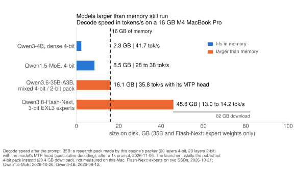
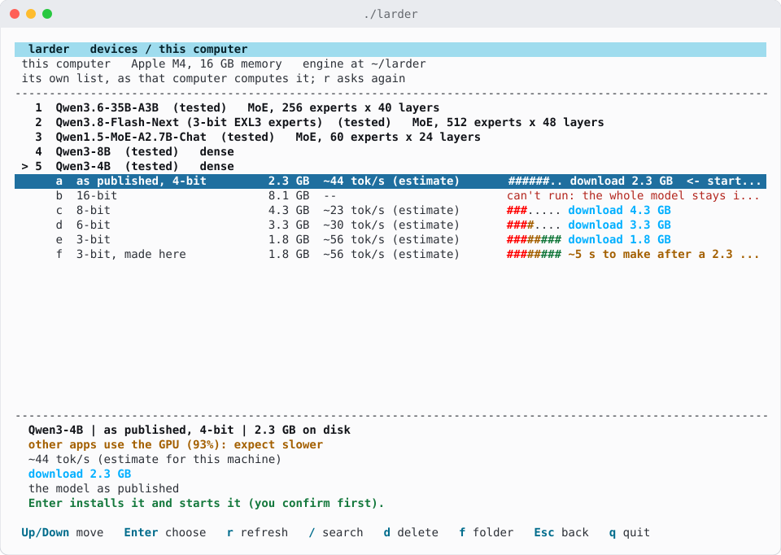
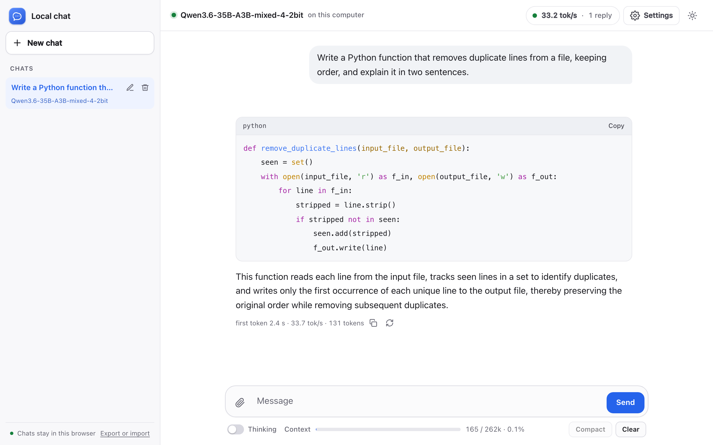
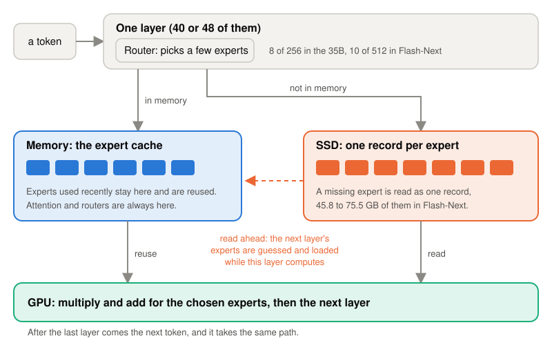

# Larder

Large AI models on an ordinary computer.

This is an inference engine that runs large language models on a computer you already own, with the model's expert weights read from an SSD as each token needs them. One command measures your machine, picks a model that fits, installs it, and gives you a chat page and an OpenAI-compatible API.

**Status: experimental.** One author, tested on two machines: a 16 GB M4 MacBook Pro and a Linux PC with an RTX 5060 Ti 16 GB. The Apple path is the most tested; CUDA is newer. See [Limits](#limits).

**Where it is ahead: models bigger than memory.** Instead of failing or swapping, Larder reads the experts each token needs from the SSD.

- Qwen3.6-35B on a 16 GB Mac: 30 to 36 tokens/s, 3.3x to 3.8x llama.cpp's best, with the first token 8x to 10x sooner. This ran a research pack with the model's MTP head and is not like for like, see [Against llama.cpp](#against-llamacpp).
- Qwen3.8-Flash-Next, 46 GB of 3-bit experts, on a PC with a 16 GB graphics card and 15 GB of RAM: 26 to 34 tokens/s. With a 4-bit research pack and exact routing it decodes 1.3x to 1.8x faster than llama.cpp and reads an 8k prompt 4.9x faster; llama.cpp's stock build swapped past the memory guard while loading the model.

**Models that fit in the graphics card and RAM.** On the PC with an RTX 5060 Ti 16 GB (2026-11-11, one session, both orders), `./larder` now installs a Q4_0 recipe of Qwen3.6-35B. Against llama.cpp's best split that fits at its default batch (the same Q4_0 file, `--n-cpu-moe 11`) it decodes 1.46x to 1.47x faster on short turns (147 against 100 tokens/s), and is level after an 8k prompt and at reading it (1.03x to 1.09x faster in decode, 1.03x to 1.05x at reading, the first token 8.7 s against 8.9 to 9.1 s). Reading a long prompt is where llama.cpp is ahead: with a 4096 batch it needs more expert layers on the CPU to fit (`-ub 4096 -b 4096 --n-cpu-moe 20`) and then reads the 8k prompt at 1,640 tokens/s, the first token after 4.9 s, against this engine's 916 (the recipe) and about 850 (exact routing): 1.8x to 1.9x faster than this engine. Its decode at that setting was 72.5 tokens/s on a 16-token run, against 86 at its default setting measured the same way; a llama.cpp user picks one setting for both. The larger batches were one run each. The recipe changes the routing (cache bias 0.5, which passed its paired GSM8K and HumanEval gate) and adds the model's own MTP head. Exact routing (cache bias 0, no head) changes nothing in the replies: it decodes 1.14x to 1.16x faster on short turns (115 tokens/s), but is 6% slower after an 8k prompt and 7% to 9% slower at reading it.

**Where it is not yet.** Reading long prompts: on the PC, llama.cpp with a 4096 batch reads an 8k prompt 1.8x to 1.9x faster than this engine, as above, and this is the next work. With exact routing the PC is also 6% behind it in decode after a long prompt. The recipe's replies are not exact repeats of the weights' own choices, and quality was not compared with llama.cpp in this measurement. This is one PC with one card: llama.cpp's default-batch setting had to be lowered from `--n-cpu-moe 10` to 11 because the desktop now holds more of the card, and a Linux or Windows PC without an NVIDIA card is not supported by the launcher (Apple Silicon Macs are).

<picture>
  <source media="(prefers-color-scheme: dark)" srcset="assets/vs-llamacpp-dark.svg">
  
</picture>

Every number here is in [research/](research/README.md) with its machine, setup and date.

## What ./larder gives you, measured

Only the models and packs the launcher installs. Speeds are decode speeds: tokens per second after the prompt has been read.

| computer | model, as the launcher installs it | decode speed | setup and date |
|---|---|---|---|
| 16 GB M4 MacBook Pro | Qwen1.5-MoE-A2.7B-Chat, 4-bit, 8.5 GB | 28 to 38 tokens/s | through `./larder` from a fresh clone, warm replies; 2026-10-26 |
| 16 GB M4 MacBook Pro | Qwen3-4B, dense 4-bit, 2.3 GB | 41.7 tokens/s | the same weights in plain MLX, 24.0 ms a token, no draft model; 2026-09-12 |
| 16 GB M4 MacBook Pro | Qwen3.8-Flash-Next, 3-bit EXL3 experts (82 GB download, 45.8 GB of experts) | 13.8 / 14.2 / 13.0 tokens/s (Russian / English / Python) | experts on the internal SSD plus a copy on an external Thunderbolt SSD, the recommended server command, 3 interleaved rounds; the internal SSD alone was 1.107x slower; 2026-10-21 |
| 16 GB M4 MacBook Pro | Qwen3.6-35B-A3B, published 4-bit pack (20.4 GB download) | not measured on the Mac | the Mac's 35B numbers further down are research configurations |
| Linux PC, RTX 5060 Ti 16 GB, 15 GB RAM | Qwen3.6-35B-A3B, the Q4_0 recipe the launcher installs on CUDA by itself (about 25 GB download: the trunk, a 20.8 GB GGUF and the 1.7 GB head) | 147 tokens/s on short turns, 100 to 106 after an 8k prompt; reads an 8k prompt at 933 to 935 tokens/s (916 in a later session; llama.cpp reads it faster with a bigger batch, see below) | the launcher's command: Q4_0 experts held resident in VRAM and a pinned host-RAM tier, cache bias 0.5, the model's MTP head; two orders in one session, 2026-11-11 |
| Linux PC, RTX 5060 Ti 16 GB | Qwen3-8B, dense 4-bit | 80.1 tokens/s | the same weights in plain MLX, a 512-token prompt and 128 new tokens, median of 3 runs; 2026-10-18 |

<picture>
  <source media="(prefers-color-scheme: dark)" srcset="assets/bigger-than-memory-dark.svg">
  
</picture>

*The 35B bar is a research configuration: a mixed 4-bit / 2-bit pack made by this engine's packer, run with the model's MTP head (speculative decoding). The launcher does not install it.*

## Install

On macOS (Apple Silicon) or Linux with an NVIDIA GPU, one line installs everything into `~/larder`:

```bash
curl -fsSL https://raw.githubusercontent.com/IamCooller/larder/main/install.sh | bash
```

It checks the computer, clones the repository, creates a Python environment, installs the packages and builds the small native reader when a compiler is there. Nothing needs administrator rights. Then:

```bash
cd ~/larder
./larder
```

`./larder` opens a full-screen menu. It measures the machine, lists the tested models with the speed it expects on this computer, and shows what Enter will do: install, download, or why a model cannot run here. The choice is installed with a progress bar, the server starts, and the screen shows the chat address, the API address and the model id.

```bash
./larder                      # the menu
./larder --model qwen1.5-moe  # skip the menu with a listed model
./larder --auto               # no questions: the recommended model
./larder --list               # the models and this machine's speed estimate
./larder stop                 # stop the server it started
./larder status               # what is running, and where
```

The manual path:

```bash
git clone https://github.com/IamCooller/larder && cd larder
python3 -m venv .venv
.venv/bin/pip install -r requirements.txt
native/build.sh .venv/bin/python   # optional: the native reader, faster expert reads
./larder
```

Without `native/build.sh` the engine still runs, on its slower Python read path. On a Mac the same script also builds the Neural Engine extension (see [Quality](#quality-what-changes-a-reply-and-what-does-not)).

## What you see

- **A menu in the terminal.** The tested models and their variants with the size on disk, an estimated speed for this computer, and a one-line reason when one does not fit. `/` searches Hugging Face, `f` takes a model folder on your computer, and the cursor starts on the model you used last time.
- **A chat page in the browser.** Streamed replies, markdown with highlighted code, a Thinking switch, image attachments when the model can see, saved conversations in a sidebar, light and dark themes, and a status panel with tokens and speed. Every asset is served by the local server; the page loads nothing from the internet.
- **An OpenAI-compatible API.** `http://127.0.0.1:8800/v1` when the server is started through `./larder`: the launcher prints the exact port and moves to the next free one if 8800 is taken. Started by hand, `server.py` listens on 8765. Editors such as Continue, Cline and GitHub Copilot Chat can use it as a custom endpoint.

<picture>
  <source media="(prefers-color-scheme: dark)" srcset="assets/menu-dark.svg">
  
</picture>

*The menu on a first run on a 16 GB M4 MacBook Pro. Every size and speed is this computer's own estimate, shown before anything is downloaded.*

<picture>
  <source media="(prefers-color-scheme: dark)" srcset="assets/chat-dark.png">
  
</picture>

*The chat page on the same Mac, a cold first reply from Qwen3.6-35B-A3B in the mixed 4-bit / 2-bit research pack, without the MTP head: 33.7 tokens/s. Captured 2026-11-07; the host name is replaced with "this computer".*

```bash
curl http://127.0.0.1:8800/v1/models
curl http://127.0.0.1:8800/v1/chat/completions \
  -H 'Content-Type: application/json' \
  -d '{"model":"local","messages":[{"role":"user","content":"Hello"}]}'
```

The API ignores the model name in a request because one server serves one model. It supports streaming, tools, image parts for vision models, `max_tokens`, `response_format`, thinking on and off, and usage counters. `docs/VSCODE.md` has working settings for the three editors.

## What you need

| | |
|---|---|
| Computers | Apple Silicon Mac with macOS (Metal); Linux x86_64 with an NVIDIA GPU (CUDA) |
| Memory | 16 GB is what we tested; the launcher sizes the expert cache from the memory free at that moment and refuses a model that cannot fit |
| Disk | the model plus 10 GB kept free for the system; the smallest tested model is 8.5 GB |
| Software | Python 3.10 or newer, git, and on macOS the Xcode command line tools for the native reader (the installer checks all three) |
| Not supported | Windows; Intel Macs; Linux without an NVIDIA GPU; AMD or Intel GPUs |

The two large models want a 16 GB machine and a fast SSD. Flash-Next's 3-bit pack is an 82 GB download with 45.8 GB of expert weights; on a 16 GB machine with a small internal disk, the experts go on an external SSD (Thunderbolt is much faster than USB).

## Models we tested, and how fast they were

These are decode speeds: tokens per second after the prompt has been read. Every row names the computer, the setup and the date. Rows marked *research configuration* ran a pack or a flag the launcher does not install or set. The launcher's own speed estimate landed at 0.88x to 1.23x of every measured speed it was checked against on the 16 GB M4 and the RTX 5060 Ti PC (checked 2026-10-26).

| model | computer | speed | setup |
|---|---|---|---|
| Qwen1.5-MoE-A2.7B-Chat, 4-bit, 8.5 GB | 16 GB M4 MacBook Pro | 28 to 38 tokens/s (estimate ~33) | the one-command path from a fresh clone: 8.5 GB downloaded and packed in 7 min, ready in 3 s, warm replies; 2026-10-26 |
| Qwen3.6-35B-A3B, mixed pack: 20 layers' experts 4-bit, 20 layers 2-bit, 16.1 GB of experts (*research configuration*) | 16 GB M4 MacBook Pro | 24.2 and 25.8 tokens/s (prose and code) | 41.4 and 38.7 ms per token with a 64-slot expert arena; 2026-10-08 |
| Qwen3.6-35B-A3B, the same mixed pack with its own MTP head (*research configuration*) | 16 GB M4 MacBook Pro | about 40 / 37 / 35 tokens/s (Russian / English / Python) | a checkpoint that ships the head, `--mtp --prefill-step 0 --keep-convs 4`, cache bias 0.5, medians of 3 launches; 2026-10-20 |
| Qwen3.6-35B-A3B, the Q4_0 recipe the launcher installs on CUDA by itself (about 25 GB download: the trunk, a 20.8 GB GGUF and the 1.7 GB head) | Linux PC, RTX 5060 Ti 16 GB | 147 tokens/s on short turns (turns 2 and 3, both orders 146.5 and 147.3), 100 to 106 after an 8k prompt; reads an 8k prompt at 933 to 935 tokens/s, first token 8.7 s | the launcher's command: Q4_0 GGUF experts held resident in VRAM plus a pinned host-RAM tier, cache bias 0.5 at budget 0.2, the model's own MTP head; its paired gate against the published 4-bit pack: GSM8K-400 331 against 338 (p 0.25), HumanEval-164 149 against 148; 2026-11-11 |
| Qwen3.6-35B-A3B, the same experts with exact routing (cache bias 0, no head) | Linux PC, RTX 5060 Ti 16 GB | 115 tokens/s on short turns, 92 after an 8k prompt; reads an 8k prompt at 809 to 844 tokens/s | the same pack and plan, same session; 2026-11-11 |
| Qwen3.6-35B-A3B, published 4-bit (20.4 GB download; what the launcher installed on this PC until 2026-11-11, and still installs on a Mac) | Linux PC, RTX 5060 Ti 16 GB | 61 to 70 tokens/s after a short prompt, 50 to 54 after an 8k prompt | the launcher's own plan: the pack's 18.1 GB of experts held resident across VRAM (9.5 to 10.1 GB in use) and a pinned host-RAM tier (`MOE_RESIDENT`), cache bias 0.5, two repeats; 2026-11-07 |
| Qwen3.8-Flash-Next, 3-bit EXL3 experts, 45.8 GB of experts | 16 GB M4 MacBook Pro | 13.8 / 14.2 / 13.0 tokens/s (Russian / English / Python) | experts on the internal SSD plus an external Thunderbolt SSD, 3 interleaved rounds; 2026-10-21 |
| Qwen3.8-Flash-Next, 3-bit EXL3 experts | Linux PC, RTX 5060 Ti 16 GB | 32.1 / 34.4 / 25.8 tokens/s (Russian / English / Python) | one SSD, `--mem-peak-gb 16`, cache bias 0.5, 256 tokens after a warm-up over HTTP, 2 interleaved rounds; 2026-10-26 |
| Qwen3-4B, dense 4-bit | 16 GB M4 MacBook Pro | 41.7 tokens/s | plain MLX decode, 24.0 ms a token, no draft model; 2026-09-12 |
| Qwen3-8B, dense 4-bit | Linux PC, RTX 5060 Ti 16 GB | 80.1 tokens/s | plain MLX, a 512-token prompt and 128 new tokens, median of 3 runs; 2026-10-18 |

The two Mac rows of the 35B ran a mixed pack made with this engine's packer, not the pack the launcher installs. On a Mac the launcher installs the published 4-bit pack; its speed there has not been measured, and it reads more bytes per expert, so expect it to be slower than those two rows.

Dense models also get faster when a small same-family draft model is already on disk: the server finds it and checks its guesses, so the reply stays the model's own greedy choice up to exact bf16 ties. In a 300-token benchmark on the 16 GB M4 (2026-09-12), Qwen3-4B went from 42.3 to 55.2-66.8 tokens/s (best 1.58x) and Qwen3-8B from 23.1 to 35.7-46.8 tokens/s (prose 1.55x, code 2.03x). On the paired benchmarks the end-to-end gain was 1.64x to 1.67x for 4B and 1.92x to 1.95x for 8B (2026-09-29).

The first token is slower than decode, because the whole prompt has to be read before the first word comes out. On the 16 GB M4, a 16k-token prompt took 45.6 s with the 35B's mixed pack (2026-10-07), and 136.2 s with Flash-Next (2026-10-25). On the RTX 5060 Ti PC, the same 16k prompt took 34.4 s with Flash-Next after its newer prefill kernels (2026-10-26). A short question is quick: 2.5 to 4.5 s for a question of 19 to 54 tokens with Flash-Next on the M4 (2026-10-14). The next message of the same conversation reads only what was added.

## Against llama.cpp

Greedy decoding against llama.cpp b11719 (the official build) at the fastest setting of a sweep, the same model on the same computer; the chart at the top of this page sums it up. Where the model is bigger than memory, this engine is faster. On a 16 GB Mac with Qwen3.6-35B-A3B it decoded 3.3x to 3.8x faster, not like for like: this engine ran an about 3-bit mixed pack with MTP speculative decoding, reading from the internal SSD and, for about 11 GB of its 23 to 24 GB a request, from a partial copy on an external USB4 SSD, while llama.cpp ran a 4.25-bit IQ4_XS file with plain decoding from that external SSD alone, one run per cell. On the NVIDIA PC with Qwen3.8-Flash-Next it decoded 1.3x to 1.8x faster, both sides at about 4 bits with exact routing. Where the model fits in the GPU and RAM, Qwen3.6-35B-A3B on the same PC (2026-11-11), at llama.cpp's default setting the launcher's recipe is ahead on short turns and level after an 8k prompt, and exact routing is level or behind there. At a 4096 batch llama.cpp reads the 8k prompt faster than this engine does, as the next paragraph and the table's note say.

| computer, model | llama.cpp, its best setting | this engine | faster |
|---|---|---|---|
| 16 GB M4 MacBook Pro, Qwen3.6-35B-A3B | unsloth's IQ4_XS (17.7 GB, about 4.25 bits), plain decoding, from an external USB4 SSD. Everything on the GPU (`-ngl 99`) does not fit and gives no reply; the best of experts on the CPU (`--n-cpu-moe 32`) and CPU only: 11.0 / 9.5 / 7.9 tokens/s after 1k / 4k / 16k-token prompts, first token after 33 / 109 / 429 s | the mixed 4/2-bit research pack (16.1 GB, about 3 bits) with its MTP head, from the internal SSD plus about 11 GB a request from the same external SSD: 35.8 / 34.4 / 30.2 tokens/s, first token after 4.2 / 10.7 / 46.4 s | this engine: 3.3x to 3.8x on decode, 8x to 10x on the first token; not like for like (bits, MTP, drives), one run per cell |
| Linux PC, RTX 5060 Ti 16 GB, 15 GB RAM, Qwen3.8-Flash-Next | unsloth's UD-Q4_K_XL (77 GB of experts). The stock build swapped more than 512 MB while loading, past the memory guard these runs used; with this engine's expert store patched in (a 6 GB store, `--n-cpu-moe 42` or `43`): 7.32 tokens/s after a short prompt (llama-bench; 4.57 on real text), 5.38 after an 8k prompt, read in 226 s | a 4-bit research pack (60.9 GB of experts), exact routing (cache bias 0), from one SSD: 9.79 tokens/s after a short prompt, 9.62 after 8k, the 8k prompt read in 46.1 s | this engine: 1.3x to 1.8x on decode, 4.9x on the first token at 8k |
| Linux PC, RTX 5060 Ti 16 GB, 15 GB RAM, Qwen3.6-35B-A3B, 2026-11-11, one session, both orders (pass 1 / pass 2) | bartowski's Q4_0 (20.8 GB, about 4.5 bits); experts split between the GPU and the CPU, `-ngl 99 --n-cpu-moe 11` (`--n-cpu-moe 10`, its best on 2026-11-09, no longer fits beside the desktop): 99.6 / 100.7 tokens/s on short turns, 97.4 / 97.3 after an 8k prompt, reads it at 891 / 904 tokens/s, first token after 9.07 / 8.94 s | the launcher's recipe: the same Q4_0 experts held resident in VRAM plus a pinned host-RAM tier, cache bias 0.5, the model's MTP head: 146.5 / 147.3 on short turns, 100.4 / 106.0 after 8k, reads it at 933 / 935 tokens/s, first token after 8.67 / 8.65 s. Exact routing (cache bias 0, no head): 115.2 / 114.8, 91.6 / 91.7, 809 / 844 tokens/s, first token after 9.99 / 9.58 s | the recipe: 1.46x / 1.47x on short decode, level after 8k (1.03x / 1.09x on decode, 1.05x / 1.03x on reading at llama.cpp's default batch; 0.56x against its 4096 batch, see below). Exact routing: 1.16x / 1.14x on short decode, 0.94x / 0.94x after 8k, 0.91x / 0.93x on reading at the default batch (0.52x against 4096) |

In a later session the same night (2026-11-11, one run each), llama.cpp b11719 on the same Q4_0 file read the 8k prompt (8,074 tokens) at 899.6 tokens/s at its default batch (`-b 2048 -ub 512`, `--n-cpu-moe 11`), the first token after 8.98 s, and 1,259.9 tokens/s at `-ub 2048 -b 2048 --n-cpu-moe 15`. Batches of 2048 and 4096 did not fit at `--n-cpu-moe 11` (the compute buffer ran out of memory). With `-ub 4096 -b 4096 --n-cpu-moe 20` it read it at 1,639.7 tokens/s, the first token after 4.92 s, the fastest prompt reading measured there; this engine read the same prompt at 916 / 915 (the recipe) and 852 / 842 tokens/s (exact routing), so llama.cpp's fastest prompt setting is 1.8x to 1.9x faster than this engine. The 4096 setting costs decode: 72.5 tokens/s on a 16-token run against 85.7 and 86.6 at the default, so llama.cpp's fastest prompt setting and its fastest decode setting differ. `--n-cpu-moe` between 15 and 20 at 4096, and larger values, were not tried; 1,640 is a floor for llama.cpp's best. The rows above compare decode against the default setting, `--n-cpu-moe 11`, and the 8k prompt reading cells in the chart against the 4096 setting.

Quality was not compared in this table. For the PC's recipe the gate is its own paired test against the published 4-bit pack (GSM8K-400 331 against 338, p 0.25; HumanEval-164 149 against 148; see below). The Mac comparison ran on 2026-11-06. The file cache could not be emptied between arms, and every cell is one run, so treat differences under about 10% as noise. The mixed pack reads fewer bytes than the 4-bit pack the launcher installs, which was not measured on the Mac. On the PC's 35B (2026-11-11), both sides ran in one session in both orders, in fresh processes, on the same Q4_0 experts; this engine's numbers are turns 2 and 3 of a server that had answered once, and llama.cpp's are its own timers for a fresh process a reply, so its first token has no warm-up to hide. This engine's short prompt was 144 tokens through the chat template, llama.cpp's 132, and this engine's first token includes the HTTP round trip. llama.cpp's expert placement is fixed by `--n-cpu-moe`; this engine's store sizes itself from the free VRAM. The recipe's replies depend on the cache's state, so they are not byte-repeatable. Flash-Next on the PC ran on 2026-11-06, one run per cell, both sides with exact routing; llama.cpp's experts were 77 GB against this engine's 60.9 GB, so this engine read fewer bytes per expert.

## Against Strata

[Strata](https://github.com/Niko1221/Strata) (v0.2.13) is built for machines with enough RAM to hold a model's experts. For Qwen3.6-35B-A3B its engine keeps every expert (about 20 GB) in RAM, its setup asks for 32 GB, and it rejects its low-RAM switches (`--mmap-experts`, `--resident-budget-gib`) for this engine. On the PC here (16 GB of VRAM, 15 GB of RAM, 2026-11-11), four settings of Strata's own server each started swapping within about ten seconds, past the +512 MB limit the runs here use (526 to 629 MB of swap growth), and none answered a request. There is no same-machine speed comparison, and the limit was not loosened: with more swap it might start and run slowly, which was not tried. Larder's measured speed on that PC for the same model is 147 tokens/s on short turns with the launcher's recipe, and 115 with exact routing (turns 2 and 3, 2026-11-11, one session). This says nothing about which engine is faster where the experts fit in RAM.

## Quality: what changes a reply, and what does not

The engine decodes greedily by default. On the same machine, the same prompt read in the same prefill passes gives the same words, apart from exact ties that bfloat16 arithmetic can break either way. Two runs can still part at a near-tied token in two cases. On CUDA, two fresh processes do not compute bit-identical logits: at an 8k prompt their top tokens agreed at 97.3% of positions, KL 0.005 (the 35B at cache bias 0, RTX 5060 Ti PC, 2026-11-06). And on any machine, a prompt split into prefill passes differently, as conversation reuse and the memory budget (`--mem-peak-gb`) do, can tip a near-tie: two plain runs of a 10-step agent loop already differed on 4 of the 10 steps (35B mixed pack, cache bias 0, 16 GB M4, 2026-09-30). A speed or memory trick is kept when the reply stays the model's own choice, or when a check found no significant change: a paired GSM8K / HumanEval test, or a KL bar for a kernel that only changes rounding. The table lists every option and default that is not bit-exact, and the check behind it.

| choice | does the reply change? | evidence |
|---|---|---|
| Default expert routing on the 35B and Flash-Next (cache bias 0.5) | in principle yes, because a near-equal expert already in memory may be chosen; in paired tests no significant difference | 35B (the mixed pack) on the 16 GB M4, GSM8K-100 87 and 82, HumanEval-164 151 and 151, pooled 9 and 4, p 0.27 (2026-10-19); Flash-Next (its 4-bit pack), 82 and 79 (p 0.45), 152 and 150 (p 0.63), 2026-10-11. On the PC, the launcher's Q4_0 recipe (cache bias 0.5 at budget 0.2, plus the model's MTP head) against the published 4-bit pack at cache bias 0: GSM8K-400 331 and 338 (p 0.25), HumanEval-164 149 and 148, pooled 264 p 1.0; the Q4_0 pack alone at bias 0, 337 of 400 and 149 of 164 (p 1.0 on both), 2026-11-10 to 2026-11-11. The recipe's interval on GSM8K reaches 4.4 points below the 4-bit pack |
| Flash-Next's 3-bit EXL3 experts (the recommended pack) | yes, slightly | perplexity 2.45% higher than the 4-bit pack; GSM8K-300 242 and 242 (p 1.00), HumanEval-164 148 and 151 (p 0.51), 16 GB M4, 2026-10-20 |
| A 3-bit copy made by the launcher (only when you pick one) | yes | Qwen1.5-MoE perplexity 7.6% higher, 6 of 6 instruction prompts still right (2026-09-12); Flash-Next plain 3-bit rounding 4.13% higher (2026-10-19) |
| The 35B mixed 4-bit / 2-bit pack (a research configuration; the launcher does not install it) | yes | lossy, with no paired gate against the 4-bit pack. Whole 2-bit experts broke instruction following, so 2-bit is kept to layers 4 to 23 |
| The Neural Engine on Flash-Next's long prompts (`MOE_ANE_OVERLAP`, Mac, on by default) | rounding only | not bit-exact: KL to an fp32 reference 0.72x the GPU path's; 24 long-prompt tasks (4.5k to 15.6k tokens) 22 and 21 right, p 1.0; 16 GB M4, 2026-11-04 |
| One matmul for Flash-Next's hyper-connection inject and down projection (`MOE_FUSE_HC`, on by default) | rounding only | not bit-exact: 4 of 6 bias-0 splits were bf16 ties; GSM8K 83 and 82 (p 1.0), HumanEval 152 and 150 (p 0.5); 16 GB M4, 2026-10-14 |
| Folded verify attention on dense models with a draft (`foldattn`, on by default) | rounding only | never further from an fp32 reference than stock; inside the draft model's paired gate, where it flipped 2 of 5 non-tie HumanEval cases; 16 GB M4, 2026-09-28 and 2026-09-29 |
| Experts held resident on CUDA (`MOE_RESIDENT`, set by the launcher for the 35B on the PC) | at long prompts, rounding only | short prompts byte-identical; at 8k the prefill is cut differently and the reply can part: teacher-forced KL 0.0070 against a run-to-run 0.0050 between two plain runs; PC, 2026-11-06 |
| Conversation reuse: a follow-up reads only what it adds (on by default, any model; `--no-reuse` turns it off) | at near-ties, yes: the prompt is read in other passes | 35B mixed pack at cache bias 0, a 10-step agent loop, 16 GB M4, 2026-09-30: every parting 0 to 0.875 logits apart, where two runs without reuse already differed on 4 of 10 steps; Qwen3-4B 9 of 10 steps identical. Under `--mem-peak-gb`, a paired gate: GSM8K-100 98 and 95 (p 0.25), HumanEval-164 147 and 146 (p 1.0), Flash-Next, 16 GB M4, 2026-10-18 |
| The GatedDeltaNet kernel on CUDA (the 35B and Flash-Next, on by default; `MOE_CUDA_GDN=0` turns it off) | rounding only | not bit-exact: the recurrent state within about 2.5 fp32 ulp of the ops path; 64 of 64 reply ids identical at equal passes; PC, 2026-10-19 |
| Decode attention over the sparse-attention picks on CUDA (Flash-Next, on by default above a length measured at install) | rounding only | not bit-exact: 99.96% of attention outputs bit-equal, the other 0.04% one bf16 step off; the golden set (7 requests) identical, needles found at 64k and 128k; PC, 2026-10-29 |
| Sampling (`--sampling` on the server) | yes, by design | the 35B's sampled tokens match plain sampling's distribution (TV 0.078 to 0.094 against a null of 0.101), 16 GB M4, 2026-10-20 |
| The Thinking switch | yes, by design | the model writes its reasoning before the answer |
| The chat page, the API and editor clients | no | replies unchanged; only the API shape and the page are different (2026-10-26) |
| A draft model on dense models | no, up to exact bf16 ties | paired GSM8K-100 and HumanEval-164, no significant difference; 1.64x to 1.67x end to end for Qwen3-4B and 1.92x to 1.95x for Qwen3-8B on the 16 GB M4 (2026-09-29) |
| Long-context kernels: QSA step buffer and picks-only attention | no | every cache array bit-identical at 72 of 72 decode passes; 1.064x at 64k on the 16 GB M4 (2026-10-25) |

The launcher sets the memory-aware routing option (cache bias 0.5) only on the 35B and Flash-Next, the two models where it passed paired gates. Qwen1.5-MoE and the dense models run with exact routing. For exact repeats on the 35B or Flash-Next, start the server yourself with `--cache-bias 0`.

The Neural Engine path calls private macOS interfaces (`AppleNeuralEngine.framework`, loaded at run time). It is on by default on a Mac where `native/build.sh` built its `_ane_mlx` extension, it acts only on Flash-Next prompts long enough for two prefill chunks or more, and it was tested only on the 16 GB M4. `MOE_ANE_OVERLAP=0` turns it off.

## Privacy and network

Larder runs on your computer. The server listens on 127.0.0.1 by default and refuses browser requests whose Origin or Host is not this computer, and the chat page loads nothing from the internet. The engine has no telemetry and no update check. These are all the network uses:

- **Install.** `install.sh` clones this repository from GitHub and installs Python packages from PyPI, with mlx-lm from a pinned commit on GitHub.
- **The menu.** Opening `./larder` reads Hugging Face metadata (revisions and file sizes) for the tested models that are not on disk yet. `/` in the menu and `--search` query Hugging Face's model search.
- **Downloads.** A model you pick is downloaded from Hugging Face. A model already on disk starts without the network.
- **`./larder share`** (experimental). It listens on your LAN and sends a UDP beacon so the menu on your other computers can find it. [SECURITY.md](SECURITY.md) describes the pairing and the encryption.
- **Devices.** The menu can scan your LAN for your other computers, only after you confirm it. Hosts from `~/.ssh/config` and Tailscale are checked over ssh when you turn devices on (`./larder --devices`); with devices off, they are also checked after you answer y to the scan question. A computer found by its share beacon is never reached over ssh. Opening a device lists, starts, deletes and updates models there over ssh, and a model started there is reached through an ssh port forward. `u` runs `git pull` there, or sends this checkout as a git bundle over ssh. Setting up a device runs the installer there over ssh.

To report a security problem, see [SECURITY.md](SECURITY.md).

## For researchers: what worked, what did not, and why

The full research record is in [research/](research/README.md):

- [research/WORKED.md](research/WORKED.md): every lever that landed (97), with the measured gain, the machine, setup and date, and the quality check it passed.
- [research/CLOSED.md](research/CLOSED.md): every idea that was tried and closed (197), with what was measured and why it was closed. The negatives are kept on purpose.
- [research/HARDWARE.md](research/HARDWARE.md): the two machines, their SSD rates, the models and packs, where a token's time goes, and the llama.cpp comparison.
- [research/README.md](research/README.md): the rules every result obeyed: exact replies or a passed check, a kill bar written before each run, measured numbers kept apart from estimates.

### Reproduce a claim

Run these from the repository folder, with no other program loading a model. `tests/README.md` has the exact commands.

1. `python3 tests/run_toys.py` runs every test that needs no weights, each in its own process, one line each. Expect skips: tests for a backend this machine lacks (CUDA on a Mac), tests that need a built extension (`native/build.sh`, `cpu_ext/build.sh`) or the mlx-lm build named in `requirements.txt`, and tests that need a tokenizer (`MOE_TOY_TOKENIZER=<any Qwen checkpoint folder>`). A skip names what is missing; it is not a pass. These tests back the "exact" and "bit-equal" claims at the unit level: kernels against MLX's own operations, the expert cache and store, conversation reuse.
2. `tools/golden_check.py record` against a build you trust, then `tools/golden_check.py check` against the new one, with the same model and flags and `--cache-bias 0`. It compares every reply byte for byte and prints the first difference. It backs the "no" rows of the Quality table and the "exact" rows of the research record.
3. `tools/quality_gate.py` runs paired GSM8K and HumanEval through two OpenAI-compatible endpoints and prints the exact McNemar p-value. It backs the paired gates (the cache bias, the EXL3 pack, a 3-bit copy, a draft model, `MOE_FUSE_HC`). It downloads no dataset (`--help` names the two files), and HumanEval runs the model's code without a sandbox. The published gates ran on the project's own harness; this is the public tool for the same paired test.

## Editors

The server speaks the OpenAI chat API, so an editor extension that accepts an "OpenAI-compatible" endpoint can use it. `docs/VSCODE.md` has copy-paste settings for Continue, Cline, and GitHub Copilot Chat's custom endpoint, plus the exact URLs for the chat page and the health check. Its sample URLs use 8765, the port a hand-started `server.py` listens on; if you started through `./larder`, put in the port it printed (8800 unless that one was busy).

Two things to know: use `127.0.0.1`, not `localhost` (some clients try the IPv6 address first), and give the first request a generous timeout, because a long prompt is read before the first token appears.

## How it works, in one page

A mixture-of-experts model is a stack of layers. Each layer has a router and many small expert networks; for every token the router picks a handful of experts, 8 of 256 in the 35B and 10 of 512 in Flash-Next. Only those experts do any work for that token. The catch is that the weights are far larger than the memory of an ordinary computer: the full 4-bit Flash-Next pack has 75.5 GB of expert weights, and the 3-bit EXL3 pack still has 45.8 GB.

So the engine keeps the part every token needs (attention, routers, embeddings) in memory, and stores each expert as one record on the SSD. When the router asks for an expert that is not in memory, the engine reads that one record, hands it to the GPU, and moves on. An expert that is already in memory is reused.



The engine also guesses which experts the next layer will need while the current layer computes, so some of the reading happens in parallel with the math. The launcher measures the GPU's speed, the disk's read speed and the free memory, then chooses the size of the in-memory expert cache. Nothing is a fixed threshold: a slower disk or a busier computer changes the choice.

`docs/HOW_IT_WORKS.md` explains the pieces in more detail: the expert cache, prompt reading, the two-drive layout, and the speculative decoding used by dense models.

## FAQ

**Why is the first reply slow?** The prompt is read before the first token. A short question can take a few seconds; a 16k-token file took tens of seconds on the machines above, and the exact times are in the speed section. The next message in the same conversation reads only the new part.

**Why does it use the SSD?** The model is bigger than memory. Only a few experts work on any one token, so reading those few is cheaper than keeping all of them in RAM. On the 16 GB M4 the internal SSD measured 3.42 GB/s (2026-10-26) and the external Thunderbolt SSD 3.38 GB/s (2026-10-13); the Linux PC's NVMe drive 4.35 GB/s in random 1 MB reads (2026-10-17).

**Can I use my own model?** Yes, if it is an MLX safetensors model and either a mixture-of-experts model with the layout the engine can stream, or a dense model that fits in memory. `./larder --model publisher/repo` takes a Hugging Face repository, and `./larder --model /path/to/folder` takes a folder. GGUF, PyTorch `.bin`, GPTQ, AWQ and FP8 checkpoints are not supported; look for an MLX conversion.

**Is my data sent anywhere?** Your prompts and replies stay on this computer: the server listens on this computer only by default, and the chat page and its libraries are served locally. The launcher talks to Hugging Face for model lists and downloads, and `share` and the devices screen use your LAN when you turn them on; [Privacy and network](#privacy-and-network) lists every case.

**Does it work offline?** Yes, after the model is downloaded. The launcher reads its notes from disk and does not need the network to start a model that is already there.

More questions are answered in `docs/FAQ.md`.

## Limits

- One model per server. A mixture-of-experts model answers one request at a time; dense models can run several requests together.
- Tested on two machines. The Linux CUDA path is newer than the Apple path and was tested on one NVIDIA card; on the PC only the launcher's 35B was measured end to end through `./larder` (the 4-bit pack on 2026-11-07, the Q4_0 recipe's install and start on 2026-11-11).
- Flash-Next needs a large download (82 GB) and an external SSD on a 16 GB machine.
- Long prompts are slow. This engine is made for chat and code assistance, not for filling in a token on every keystroke.
- There is no training, fine-tuning, embeddings endpoint or `/v1/completions` endpoint.
- The server listens on 127.0.0.1 by default. Binding it to another address (`--host`) needs `--api-key`, and every API request must then carry the key (`Authorization: Bearer` or `x-api-key`). Without `--tls-cert` and `--tls-key`, the key and every request travel in clear text; [SECURITY.md](SECURITY.md) has the details.
- `./larder share`, which lets the menu on one of your computers use a model on another one over the LAN, is experimental. It needs `openssl` for TLS: without it, share refuses to start unless you pass `--no-tls`, which sends the pairing and every request in clear text. [SECURITY.md](SECURITY.md) has the details.

## Uninstall and where files live

Nothing is installed outside these places:

- **The engine**: the folder it was installed into (`~/larder` from `install.sh`, or your clone) with its
  `.venv`. The native extensions (`moe_native`, `_ane_mlx`) are built into the Python that runs the engine,
  which is that `.venv` when there is one.
- **Models**: `~/.cache/moe-ssd-offload/models/<id>/`, or the folder you gave `--models-dir`. Flash-Next takes up
  to ~82 GB. `./larder --delete ID --variant KEY --yes` removes one model.
- **Everything else the launcher and the engine keep**: `~/.cache/moe-ssd-offload/` (the machine profile and its
  measurements, server logs, calibrations, measured speeds, stored prompt prefixes, and the share certificate
  and pairings).
- **Saved expert profiles and memory states**: `~/.cache/moe-brain/`, written only when a program uses the
  library's profile or memory features.
- **Hugging Face's cache**: `~/.cache/huggingface/` holds the small config files the launcher reads before a
  download. Other programs share it; leave it if you use them.

To remove everything:

```bash
./larder stop
rm -rf ~/.cache/moe-ssd-offload ~/.cache/moe-brain ~/larder     # or the folder you cloned into
```

## Credits and licences

This project is built on other people's work:

- [ddalcu/sushi](https://github.com/ddalcu/sushi), a fork of [beamivalice/sushi](https://github.com/beamivalice/sushi): the EXL3 expert kernels for Metal and CUDA, MIT licence.
- [turboderp-org/exllamav3](https://github.com/turboderp-org/exllamav3): the EXL3 file format and its trellis tiles, MIT licence.
- [ml-explore/mlx](https://github.com/ml-explore/mlx): the array and GPU framework, and the operation order of several decode, attention and routing kernels, MIT licence.
- [ml-explore/mlx-lm](https://github.com/ml-explore/mlx-lm): model definitions, tokenizers and generation, MIT licence. It is installed from a pinned commit of a community fork (eauchs/mlx-lm), kept at [IamCooller/mlx-lm](https://github.com/IamCooller/mlx-lm) so the install does not depend on someone else's account.
- [Blaizzy/mlx-vlm](https://github.com/Blaizzy/mlx-vlm): the Qwen3-VL vision tower that `vision.py` ports, MIT licence.
- [beamster/Qwen3.8-Flash-Next-Sushi-3bpw](https://huggingface.co/beamster/Qwen3.8-Flash-Next-Sushi-3bpw): the 3-bit EXL3 expert pack the launcher downloads for Flash-Next, Qwen Community License 1.0.
- [ggml-org/llama.cpp](https://github.com/ggml-org/llama.cpp) (ggml, gguf-py): the GGUF block formats and their dequantization, ported to Metal and CUDA kernels, MIT licence.
- [markedjs/marked](https://github.com/markedjs/marked), 18.1.2: markdown rendering in the chat page, MIT licence.
- [cure53/DOMPurify](https://github.com/cure53/DOMPurify), 3.4.17: sanitising rendered markdown, Apache 2.0 or MPL 2.0.
- [highlightjs/highlight.js](https://github.com/highlightjs/highlight.js), 11.12.0: code highlighting, BSD 3-Clause licence.

The full notices and licence texts are in `THIRD_PARTY_NOTICES.md`. The model weights have their own licences from their publishers; the launcher shows the licence of each tested model.

This project is released under the MIT licence; see `LICENSE`.
